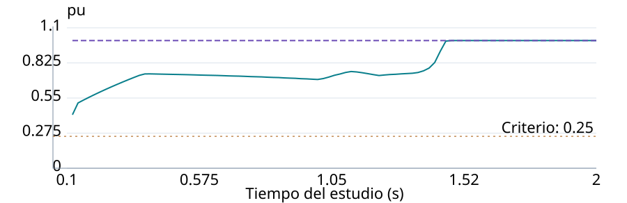

# Q9 - Informes de motores y comparación de casos

17 de octubre de 2026. Presentación de resultados Modelica guardados, sin ejecutar
el solver ni cambiar los alcances DOL/SCR comprobados.

## Qué entrega

- Gráficos separados por caso y motor: corriente RMS de línea, velocidad,
  par electromagnético y tensión. Barra y terminal tienen curvas y etiquetas
  distintas; una medición ausente no se sustituye por la otra.
- Tabla comparativa con frecuencia, método, instante de orden, duración de
  aceleración, mínimos de tensión y corriente máxima. Cada caso conserva su
  propia red, criterios y fuentes. La comparación no demuestra por sí sola
  que un método sea mejor.
- Refinamiento numérico y cumplimiento de criterios separados. Fallo de
  ejecución, datos faltantes o refinamiento pendiente no se muestran como
  aceptación de diseño. Los resultados históricos conservan su calificación.
- HTML autocontenido, SVG descargables, CSV de comparación y trayectorias,
  copias JSON de entradas/resultados e inventario con hashes verificable.
- Diseño adaptable a pantalla angosta, con desplazamiento local del gráfico;
  impresión A4 horizontal con inicio de página por motor.



El ejemplo es un banco sintético de integración SCR, no una bomba del proyecto.
El mínimo terminal durante la rampa y el mínimo de barra son magnitudes diferentes.
El criterio de 0,25 pu pertenece al banco y no es un mínimo normativo universal.

## Semántica y alcance

Los ejes de tiempo usan segundos desde el inicio del estudio. La aceleración
es duración desde la orden del motor; el bypass se expresa desde el inicio
del estudio. No se alinean automáticamente casos con arranques distintos.

La corriente es el máximo de las tres corrientes RMS por ciclo; el par es el
promedio por ciclo y la velocidad se lee al final del ciclo. La tensión es
el mínimo RMS entre pares de líneas dividido por la base LL de la red. Se
conservan los puntos por ciclo, sin reconstruir las ondas instantáneas.

Las vistas largas conservan mínimos y máximos por bloques para cada serie.
Los huecos de datos permanecen como huecos. CSV/JSON conserva la trayectoria
por ciclo completa, mientras los CSV incluyen las magnitudes resumidas
indicadas en sus encabezados. Los vectores trifásicos originales permanecen
en Results.json y ReportData.json.

Se muestran los criterios evaluados por el adaptador y su referencia. No
se inventan límites de corriente o tensión de barra. Si faltan criterios,
su referencia, observaciones o verificación, el cumplimiento queda no evaluable.
Un fallo del motor de cálculo no demuestra incumplimiento del diseño eléctrico.

## Uso MCP

Consultar `obtener_contrato_informe_dinamica_modelica`. Para un estudio nuevo,
`ejecutar_dinamica_modelica` crea automáticamente una carpeta `Report`.
El resultado MCP incluye `presentation`, separado del estado numérico.
`Results.json` conserva el resultado canónico guardado antes de presentar;
un problema del informe no cambia un cálculo válido a fallo de diseño.

Para comparar hasta ocho estudios ya guardados:

```json
{
  "estudios": [
    {"case_id": "DOL", "study_directory": "C:/estudios/DOL"},
    {"case_id": "SCR", "study_directory": "C:/estudios/SCR"}
  ],
  "directorio_salida": "C:/estudios/comparacion-nueva"
}
```

Enviar ese objeto a `generar_informe_dinamica_modelica`. Cada directorio debe
contener Inputs.json y Results.json del adaptador MSL. No requiere runtime
Modelica instalado para presentar archivos existentes. La carpeta de salida
debe ser nueva y los estudios fuente no se modifican.

`verificar_informe_dinamica_modelica` recibe `directorio_informe` y comprueba
inventario exacto, checksum del índice y hashes de todos los archivos.
Los hashes identifican los archivos capturados; no autentican al autor ni
recalifican una ejecución. Si existe hash previo de Inputs.json, debe coincidir.

## Verificación reproducible

Las pruebas comprueban valores por motor, conservación de fuentes, unidades,
curvas independientes, datos faltantes, discontinuidades, extremos durante
reducción visual, HTML/CSV literales e integridad. La integración automática
se verifica también con fallos de ejecución, sin convertirlos en fallo de diseño.

El banco MCP de presentación usa datos de prueba explícitamente identificados.
El banco local de estudios nativos guardados presenta ocho casos DOL/SCR,
14 motores y 1.815 filas de trayectoria; no vuelve a resolver la física.
Ambos bancos comprueban conservación del circuito y de los archivos originales.
Ver [evidencia MCP nativa](evidence/motor_report_q9_native.json) y
[revisión visual](evidence/motor_report_q9_browser.json).

```powershell
python -m pytest tests/test_motor_study_report.py tests/test_modelica_motor_adapter.py -q
python scripts/verify_motor_report_mcp.py --output carpeta-nueva
python scripts/verify_motor_report_mcp.py --output carpeta-nueva-nativa --studies casos.json
```

La CI repite pruebas y MCP con fixtures en Linux/Windows. Para repetir la
revisión del navegador, instalar Playwright en el entorno de pruebas y ejecutar:

```text
node scripts/verify_motor_report_browser.cjs carpeta-del-informe carpeta-nueva-QA
```

`Q9_BROWSER_EXECUTABLE` permite seleccionar un navegador Chromium instalado;
`PLAYWRIGHT_MODULE` permite señalar el módulo de prueba sin añadirlo al servidor.
La comprobación produce screenshots de escritorio/móvil, PDF y evidencia.
La revisión PDF local se realizó con todas las páginas renderizadas, además
de comprobar el número de páginas y el texto. No se añade Playwright al runtime MCP.

Q9 cierra este alcance de presentación de motores. No modifica otros informes
ni habilita automáticamente el unifilar completo, VFD, fabricante o Arc Flash.
